# ER diagram — `foodstore_db`

Sơ đồ dựng từ `src/main/resources/schema.sql` (bản đã đối chiếu), liệt kê khóa và cột then chốt. **Nguồn duy nhất của schema là `schema.sql`**; khi `schema.sql` đổi thì cập nhật file này.

```mermaid
erDiagram
    categories ||--o{ products : "phân loại"
    products ||--o{ combo_components : "combo_id (combo chứa)"
    products ||--o{ combo_components : "component_id (là thành phần)"
    products ||--o{ order_items : "được gọi"
    products ||--o{ recipes : "có công thức"
    ingredients ||--o{ recipes : "được dùng"
    dining_tables |o--o{ orders : "phục vụ tại bàn"
    customers |o--o{ orders : "đặt"
    staff ||--o{ orders : "tạo đơn"
    orders ||--|{ order_items : "gồm"
    orders ||--o| payments : "thanh toán một lần"
    orders ||--o| deliveries : "giao hàng (đơn DELIVERY)"
    shippers |o--o{ deliveries : "được phân công"
    vouchers |o--o{ payments : "áp dụng"
    suppliers ||--o{ stock_imports : "cung cấp"
    staff ||--o{ stock_imports : "lập phiếu"
    stock_imports ||--|{ stock_import_items : "gồm"
    ingredients ||--o{ stock_import_items : "được nhập"

    staff {
        bigint id PK
        varchar username "UNIQUE"
        varchar password_hash "BCrypt"
        varchar full_name
        varchar phone "nullable"
        enum role "ADMIN CASHIER WAITER CHEF"
        boolean is_active
    }
    categories {
        bigint id PK
        varchar name "UNIQUE"
    }
    products {
        bigint id PK
        bigint category_id FK
        varchar name
        enum product_type "FOOD DRINK COMBO"
        decimal price "DECIMAL(12,0) >= 0"
        varchar description "nullable"
        boolean is_active "xóa mềm"
    }
    combo_components {
        bigint combo_id PK
        bigint component_id PK
        int quantity "> 0"
    }
    dining_tables {
        bigint id PK
        varchar code "UNIQUE"
        int seats "> 0"
        enum status "FREE OCCUPIED RESERVED"
    }
    customers {
        bigint id PK
        varchar full_name
        varchar phone "UNIQUE"
        int points ">= 0"
        enum tier "NORMAL SILVER GOLD"
    }
    vouchers {
        bigint id PK
        varchar code "UNIQUE"
        enum discount_type "PERCENT FIXED"
        decimal discount_value "> 0"
        decimal min_order
        date valid_from
        date valid_to
        int usage_limit "NOT NULL"
        int used_count "<= usage_limit"
    }
    orders {
        bigint id PK
        bigint table_id FK "nullable"
        bigint customer_id FK "nullable"
        bigint staff_id FK "NOT NULL"
        enum order_type "DINE_IN TAKEAWAY DELIVERY"
        enum status "NEW PREPARING SERVED PAID CANCELLED"
        datetime created_at
        varchar note "nullable"
    }
    order_items {
        bigint id PK
        bigint order_id FK
        bigint product_id FK
        int quantity "> 0"
        decimal unit_price "giá chụp lúc gọi"
        varchar note "nullable"
    }
    shippers {
        bigint id PK
        varchar full_name
        varchar phone "UNIQUE"
        varchar vehicle_plate "nullable"
        boolean is_active "xóa mềm"
    }
    deliveries {
        bigint id PK
        bigint order_id FK "UNIQUE"
        bigint shipper_id FK "nullable"
        enum status "PENDING ASSIGNED DELIVERING DELIVERED FAILED CANCELLED"
        varchar recipient_name
        varchar recipient_phone
        varchar address
        decimal delivery_fee ">= 0"
        int attempt_count "số lần đi giao"
        varchar fail_reason "nullable"
        datetime created_at
        datetime assigned_at "nullable"
        datetime picked_up_at "nullable"
        datetime delivered_at "nullable"
    }
    suppliers {
        bigint id PK
        varchar name
        varchar phone "nullable"
        varchar address "nullable"
    }
    ingredients {
        bigint id PK
        varchar name "UNIQUE"
        varchar unit
        decimal stock_quantity ">= 0"
        decimal min_quantity ">= 0"
    }
    recipes {
        bigint product_id PK
        bigint ingredient_id PK
        decimal quantity "cho 1 phần, > 0"
    }
    stock_imports {
        bigint id PK
        bigint supplier_id FK
        bigint staff_id FK "NOT NULL"
        datetime import_date
    }
    stock_import_items {
        bigint id PK
        bigint import_id FK
        bigint ingredient_id FK
        decimal quantity "> 0"
        decimal unit_cost
        date expiry_date "nullable, theo lô"
    }
    payments {
        bigint id PK
        bigint order_id FK "UNIQUE"
        bigint voucher_id FK "nullable"
        decimal subtotal
        decimal discount_amount "<= subtotal"
        decimal vat_amount
        decimal total "= subtotal - discount + vat"
        enum method "CASH CARD TRANSFER EWALLET"
        datetime paid_at
    }
```

## Chuyển sang lược đồ quan hệ (tóm tắt)

- `combo_components(combo_id, component_id, quantity)` — khóa chính ghép; cả hai cột là khóa ngoại tới `products(id)`. Đây là quan hệ nhiều-nhiều tự tham chiếu của `products`; `CHECK (combo_id <> component_id)` chặn combo chứa chính nó.
- `recipes(product_id, ingredient_id, quantity)` — quan hệ nhiều-nhiều giữa `products` và `ingredients`, khóa chính ghép.
- `payments.order_id UNIQUE` — biến quan hệ `orders`–`payments` thành 1–0..1, chặn thanh toán đôi ở mức DB.
- `orders.table_id`, `orders.customer_id`, `payments.voucher_id`, `stock_import_items.expiry_date` nullable — quan hệ/giá trị tùy chọn (đơn mang đi không có bàn; khách vãng lai; không dùng voucher; lô không có hạn).
- `orders.staff_id` và `stock_imports.staff_id` NOT NULL — mỗi đơn/phiếu nhập phải gắn với nhân viên thực hiện.
