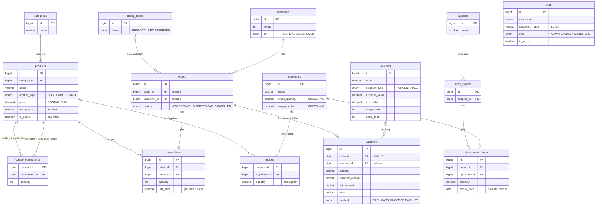

# ER diagram — `foodstore_db`

Sơ đồ dựng từ mục Data Model của `SPEC.md`, chỉ liệt kê khóa và cột then chốt. **Nguồn duy nhất của schema là `src/main/resources/schema.sql`**; khi `schema.sql` đổi thì cập nhật file này.

## Chuyển sang lược đồ quan hệ (tóm tắt)

- `combo_components(combo_id, component_id, quantity)` — khóa chính ghép; cả hai cột là khóa ngoại tới `products(id)`. Đây là quan hệ nhiều-nhiều tự tham chiếu của `products`.
- `recipes(product_id, ingredient_id, quantity)` — quan hệ nhiều-nhiều giữa `products` và `ingredients`, khóa chính ghép.
- `payments.order_id UNIQUE` — biến quan hệ `orders`–`payments` thành 1–0..1, chặn thanh toán đôi ở mức DB.
- `orders.table_id`, `orders.customer_id`, `payments.voucher_id` nullable — quan hệ tùy chọn (đơn mang đi không có bàn; khách vãng lai; không dùng voucher).
